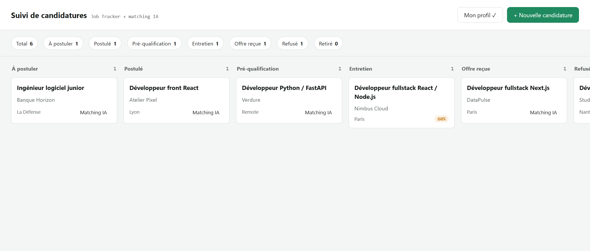
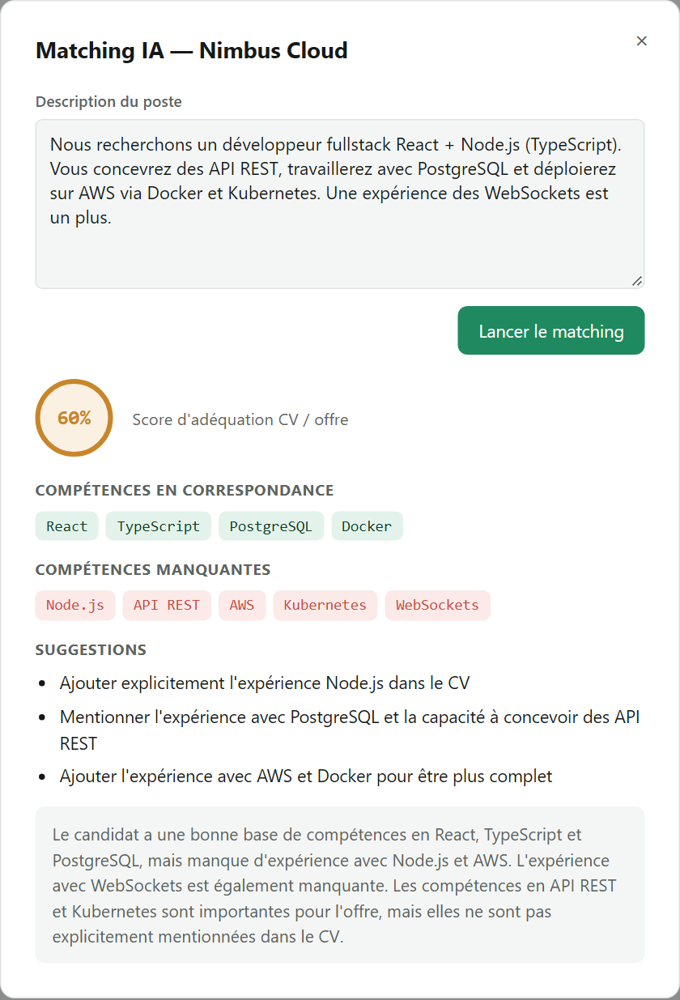

# Job Tracker IA

[](https://github.com/oussamaa29/job-tracker-ai/actions/workflows/ci.yml)

Suivi de candidatures avec matching IA entre ton CV et une offre d'emploi. Kanban par statut, profil CV réutilisable, score d'adéquation généré par un LLM local (Ollama) avec mots-clés en correspondance/manquants et suggestions concrètes.





## Pourquoi ce projet

Centraliser ses candidatures (statuts, relances, deadlines) et comparer automatiquement une offre à son propre CV pour savoir où postuler en priorité et quoi ajuster dans son profil.

## Stack

| Couche | Techno |
|--------|--------|
| Frontend | React + TypeScript (Vite) |
| Backend | FastAPI (Python) |
| Base de données | SQLite (via SQLAlchemy) |
| IA | Ollama local (`mistral` par défaut, testé aussi avec `llama3.2:3b`) : sortie contrainte par un schéma JSON, validée par Pydantic, appels déterministes (temperature 0, graine fixe) |

## Lancer le projet en local

### Backend

```bash
cd backend
python -m venv venv
venv/Scripts/activate        # Windows
pip install -r requirements-dev.txt   # dépendances + outils de test
cp .env.example .env
uvicorn main:app --reload --port 8010
```

### Frontend

```bash
cd frontend
npm install
cp .env.example .env
npm run dev
```

Ouvrir `http://localhost:5173`. Le matching IA nécessite Ollama démarré (`ollama serve`) avec le modèle `mistral:latest` (`ollama pull mistral`).

## Fonctionnalités

- CRUD complet des candidatures (entreprise, poste, statut, source, lieu, salaire, notes, description de poste)
- Vue Kanban par statut (À postuler → Postulé → Pré-qualification → Entretien → Offre reçue / Refusé / Retiré)
- Profil CV unique réutilisé pour chaque matching
- Matching IA : score d'adéquation, compétences en correspondance / manquantes, suggestions d'amélioration, justification
- Statistiques en tête de page (total et répartition par statut)

## Fiabilité du matching IA

Un LLM ne respecte pas toujours le format demandé dans le prompt. La première version, si elle ne trouvait pas de JSON dans la réponse, enregistrait un score de 0 comme s'il s'agissait d'un vrai résultat. Désormais :

- le schéma JSON du résultat est transmis à Ollama (*structured outputs*), qui contraint la génération à ce format ;
- la réponse est validée par Pydantic : score entre 0 et 100, listes de chaînes, aucun champ manquant ;
- une réponse invalide est relancée une fois avec une autre graine (avec `temperature: 0` et la même graine, le modèle répondrait exactement pareil) ;
- après deux échecs, l'API renvoie une 502 avec un message clair, et **rien n'est enregistré** : l'ancien résultat reste affiché.

Le score de la carte du Kanban est cliquable et rouvre le détail du matching.

## Tests

```bash
cd backend
pytest
```

22 tests : parsing et validation des réponses du modèle (Ollama simulé : JSON valide, bloc Markdown, score hors bornes, champ manquant, relance, Ollama injoignable, timeout, erreur HTTP), API (CRUD, statuts invalides refusés, filtre, statistiques, profil, matching enregistré ou non). La CI GitHub Actions exécute les tests, le lint et le build du frontend.

## Limites

Outil **local et mono-utilisateur** : pas d'authentification, un seul profil CV. Pour un usage en ligne, il faudrait des comptes, et un profil et des candidatures rattachés à chaque utilisateur.

## Structure

```
job-tracker-ai/
├── backend/
│   ├── main.py            # Routes FastAPI (CRUD, matching, profil, stats)
│   ├── models.py           # Modèles SQLAlchemy
│   ├── schemas.py          # Schémas Pydantic
│   ├── ai_matching.py      # Appel Ollama (sortie contrainte) + validation + relance
│   ├── tests/              # Tests pytest
│   ├── database.py
│   └── config.py
└── frontend/
    └── src/
        ├── App.tsx          # Board Kanban
        ├── api.ts           # Client HTTP
        ├── types.ts
        └── components/
            ├── ApplicationForm.tsx
            ├── ApplicationCard.tsx
            ├── MatchingPanel.tsx
            └── ProfileModal.tsx
```

## Licence

MIT
